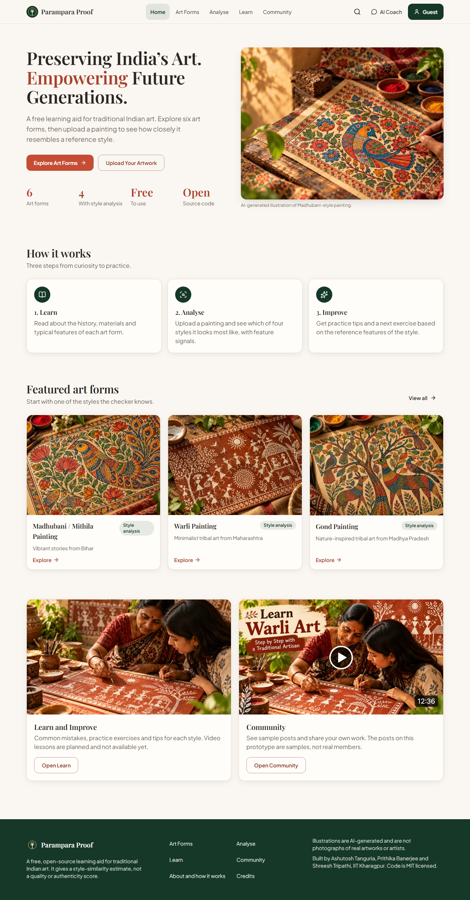
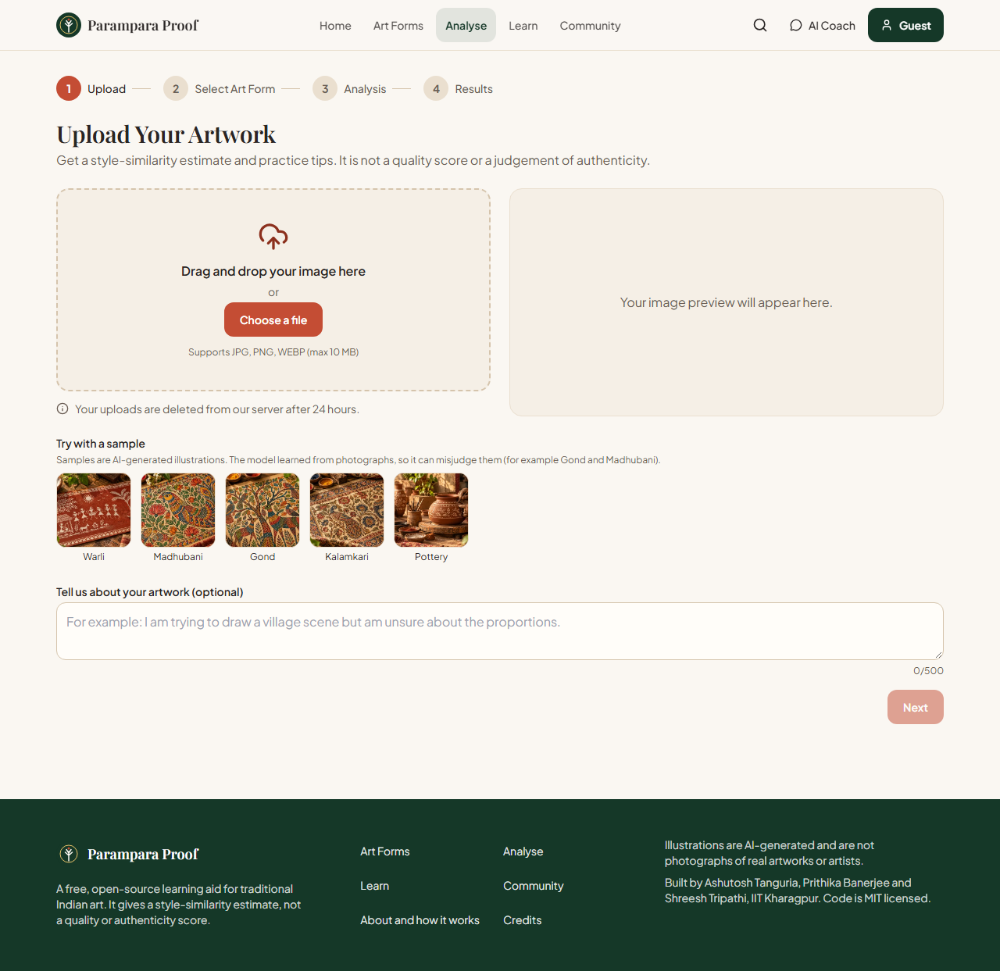
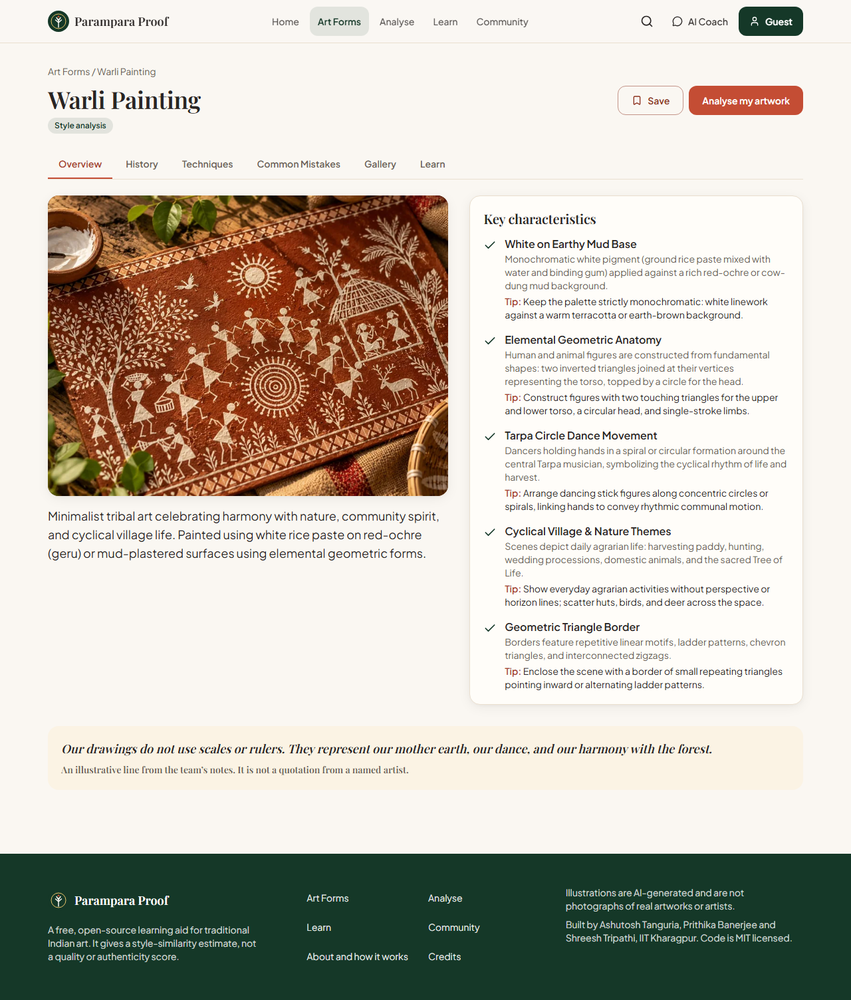
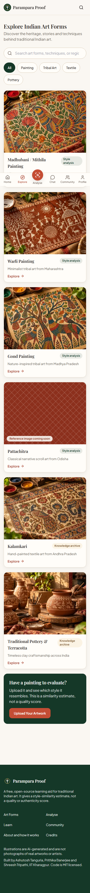
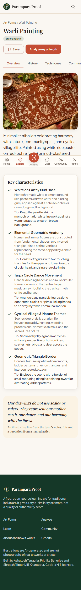
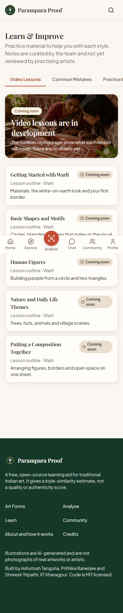
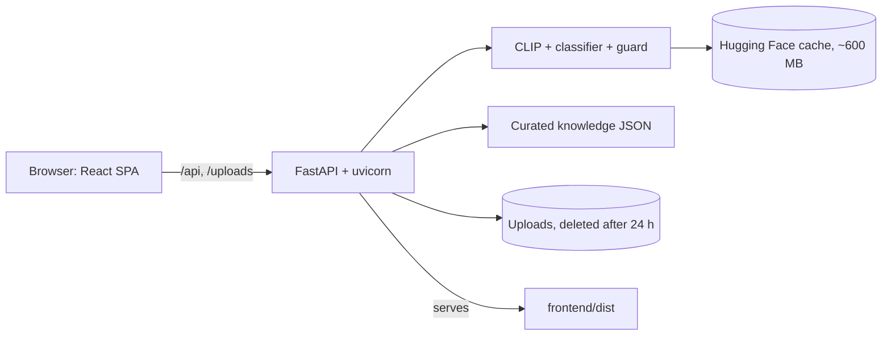

# Parampara Proof

A free, open-source learning aid for traditional Indian art. Explore six art forms, then upload a painting to see **which of four styles it most resembles**, with practice tips. It is a competition prototype by students of IIT Kharagpur.

> **Honest by design.** The checker gives a *style-similarity estimate* from a small model. It is **not** a quality score, a grade, a certificate of authenticity or an expert judgement. See [Model summary](#model-summary-honest) and `docs/MODEL_CARD.md`.

**Who it is for:** learners and hobbyists practising Madhubani, Warli, Gond or Pattachitra who want a quick, private second opinion and next-step exercises; teachers who want a simple classroom demo of how image models see art.

| Home | Upload and analyse | Results |
|---|---|---|
|  |  |  |

| Explore (phone) | Art form (phone) | Learn (phone) |
|---|---|---|
|  |  |  |

(Screenshots are produced by the Playwright suite into `docs/screenshots/`.)

## Features
- **Explore** six art forms (Madhubani, Warli, Gond, Pattachitra, Kalamkari, pottery) with overview, history, techniques, common mistakes, gallery and a practice exercise.
- **Analyse** a painting: drag and drop or pick a file, choose the art form, see real upload progress (with cancel and retry), and get probabilities for the four supported styles, feature signals, strengths, areas to improve and a next exercise.
- **Honest results:** "Style similarity" (not a score), a low-confidence warning below 50%, "Unable to assess" for unreliable checks, a not-a-painting guard, and a note when the closest style differs from the one you chose.
- **Share and print:** Web Share (or copy link) and a print-friendly report (`Download report`).
- **Coach chat** answering from the team's curated notes (rule-based, no AI model), with optional voice input where the browser supports it.
- **Community and portfolio** with sample posts clearly tagged "Sample"; your history and saved items stay in your browser.
- Responsive from 360 px phones to 1920 px screens, keyboard accessible, reduced-motion aware.
- Kalamkari and pottery are guidance only: no automated analysis, no probabilities.

## Model summary (honest)
- **What:** CLIP ViT-B/32 image embedding -> logistic regression over 4 classes (Madhubani, Warli, Gond, Pattachitra), plus 20 CLIP text prompts used as a feature checker.
- **Data:** 132 cleaned images from Wikimedia Commons (Madhubani 30, Warli 41, Gond 33, Pattachitra 28); 179 were collected. Licences and authors: `backend/image_credits.csv`.
- **Accuracy (reported by the team):** 79% in 5-fold cross-validation; 78% on a separate 20% hold-out (27 images). F1: Gond 0.90, Warli 0.85, Pattachitra 0.85, **Madhubani 0.49 (weak)**.
- **Feature checks:** only **4 of 20** are reliable (Warli: white on earth, geometric figures, circle dance; Pattachitra: big eyes). All others show "Unable to assess".
- **What it is not:** a quality or authenticity score. `overall_score` is always `null`.
- **Known limits:** trained on photographs, so it can misjudge illustrations. In our own check it recognised the Warli sample illustration but not the Gond one (`sample_data/README.md`). Beginner drawings, photos, screenshots and mixed styles can fall anywhere.
- **Content:** descriptions and tips are curated by the team and **have not been reviewed by traditional artists**.
- Illustrations on the site are **AI-generated** and are not photographs of real artworks or artists.

## Architecture

More diagrams (request sequence, model pipeline, training, deployment, route map): `docs/TECHNICAL_DESIGN.md`.

## Setup

**Prerequisites:** Git; Python 3.12 (3.10 to 3.12 should work; tested on 3.12); Node.js 20 or newer (tested on 22 and 24); about 3 GB free disk (PyTorch and the CLIP weights); 2 GB RAM minimum. Internet is needed **once**, to download the CLIP weights (about 600 MB).

### 1. Backend (all platforms)
```bash
git clone <this repository> && cd <folder>

# Windows PowerShell
py -3.12 -m venv .venv
.\.venv\Scripts\Activate.ps1
# macOS / Linux
python3 -m venv .venv && source .venv/bin/activate

# CPU-only PyTorch first (much smaller than the default), then the rest
pip install torch --index-url https://download.pytorch.org/whl/cpu
pip install -r requirements.txt            # add: -r requirements-dev.txt for tests and lint
```
`scikit-learn` is pinned to **1.6.1** because the saved model was created with it; the API refuses to analyse with a different version.

Optional but recommended: download the model once now so the first start is quick and later runs can be offline.
```bash
python scripts/download_model.py
# afterwards, run without network access:
#   Windows PowerShell:  $env:HF_HUB_OFFLINE = "1"
#   macOS / Linux:       export HF_HUB_OFFLINE=1
```

### 2. Frontend
```bash
cd frontend
npm install
```

### 3. Run
**Production mode (one port, what Docker does):**
```bash
cd frontend && npm run build && cd ..
uvicorn backend.main:app --port 8000        # from the repository root
# open http://localhost:8000
```
**Development mode (hot reload):** two terminals.
```bash
uvicorn backend.main:app --reload --port 8000     # repository root
cd frontend && npm run dev                        # http://localhost:5173, proxies /api and /uploads to 8000
```
The server loads the model at startup (a few seconds after the weights are cached). Check `http://localhost:8000/api/health`: `"model_loaded": true`.

### 4. Tests and checks
```bash
ruff check backend scripts ml tests           # lint (Python)
pytest                                        # backend tests; model tests need the CLIP weights
cd frontend
npm run check                                 # typecheck, lint, vitest, build
npx playwright install chromium               # once
npx playwright test                           # end-to-end; needs `npm run build` first. Set PYTHON to your venv's python
python ../scripts/verify_model.py             # model file checksums
```
Latest results: `docs/TEST_REPORT.md`.

## Demo: accounts, craftspeople videos, marketplace and messages
These pages are a **demo** of where the platform could go. Everything seeded is labelled "Demo data"; nobody is verified; the marketplace has no checkout and takes no payments.
```powershell
.\.venv\Scripts\python.exe scripts\seed_demo.py     # once: creates 3 demo craftspeople, 1 demo learner, 6 placeholder videos, 8 listings
```
Data lives in a local SQLite file under `backend/data/` (git-ignored). Demo logins (password `Demo-Pass-2026`, local demo only): `demo.madhubani@example.com`, `demo.warli@example.com`, `demo.gond@example.com` (Craftsperson) and `demo.learner@example.com` (Learner).
- **Login:** username (email-style) + password; passwords are hashed with scrypt; the session is a signed HTTP-only cookie. Set `SESSION_SECRET` for anything public (a warning is logged while the built-in development secret is in use).
- **Videos:** craftspeople add a YouTube link or upload MP4/WebM (max 50 MB, checked by content). YouTube loads only after you press play.
- **Messages:** one-to-one text, polled every few seconds, shown as plain text only.
- **Marketplace:** indicative prices in INR, up to 4 images per listing (JPG/PNG/WebP, 5 MB each). No "verified" or "authentic" labels anywhere.
- Demo listing pictures are the team's AI-generated illustrations, not real products. Demo videos are placeholders with no video attached.

## Docker
```bash
docker compose up --build        # then open http://localhost:8000
```
The image builds the frontend, installs CPU-only PyTorch, verifies the model checksums and bakes the CLIP weights in at build time, so the running container needs no internet. Uploads live in a volume (`/data/uploads`) and are deleted after 24 hours. The container runs as a non-root user with `STRICT_MODEL_CHECK=1` (it refuses to start if the model files do not match `backend/model_manifest.json`).

## Environment variables
Copy `.env.example` to `.env` (optional). Real environment variables win over `.env`.

| Name | Default | Meaning |
|---|---|---|
| `PORT` | `8000` | Port (used by Docker's `CMD`; pass `--port` to uvicorn locally) |
| `LOG_LEVEL` | `INFO` | JSON log level |
| `MODEL_DIR` | `backend` | Folder holding the model and content files |
| `UPLOAD_DIR` | `backend/uploads` | Where re-encoded uploads are stored |
| `UPLOAD_TTL_HOURS` | `24` | Uploads and analyses older than this are deleted |
| `MAX_UPLOAD_MB` | `10` | Maximum upload size (the web UI text assumes 10) |
| `ALLOWED_ORIGINS` | `http://localhost:5173,http://localhost:8000` | Comma-separated CORS origins (no `*`) |
| `RATE_LIMIT_PER_MIN` | `20` | Per-IP requests per minute for `/api/analyze` and `/api/chat` (0 = off) |
| `HF_HOME` | Hugging Face default | Cache folder for the CLIP weights |
| `HF_HUB_OFFLINE` | `0` | Set `1` to forbid network access once the weights are cached |
| `MAX_CONCURRENT_INFERENCE` | `2` | Parallel analyses |
| `ANALYZE_TIMEOUT_S` | `60` | Per-analysis timeout (504 afterwards) |
| `CLEANUP_INTERVAL_S` | `600` | How often expired uploads are removed |
| `STRICT_MODEL_CHECK` | `0` | `1` = refuse to start if the model cannot load or fails the checksum, class or version check. Otherwise the API starts "degraded" and `/api/analyze` returns 503 |
| `DATA_DIR` | `backend/data` | SQLite database and uploaded videos/listing images |
| `SESSION_SECRET` | dev default (warns) | Secret for signing login cookies; set your own for any public site |
| `COOKIE_SECURE` | `0` | `1` marks the login cookie Secure (use with HTTPS) |
| `SESSION_DAYS` | `7` | Login lifetime |
| `FRAME_ANCESTORS` | `'none'` | CSP `frame-ancestors` (set to `https://huggingface.co` for a Space) |

## Deployment notes
- **Hugging Face Space (Docker) or Render:** use the `Dockerfile`; expose port 8000 (`PORT`). Allow **at least 2 GB RAM**. If you do not bake the weights into the image, the first start downloads about 600 MB and takes longer; the Docker build in this repository does bake them in. For a Space set `FRAME_ANCESTORS=https://huggingface.co`.
- Uploads and results are in memory/on local disk only and are lost on restart on hosts with ephemeral storage. That is intended for a privacy-friendly prototype.
- Behind a proxy the per-IP rate limit sees the proxy's address; put rate limiting at the proxy for real deployments.

## API
Summary: `GET /api/health`, `/api/art-forms`, `/api/art-forms/{slug}`, `/api/lessons`, `/api/credits`, `/api/community`, `/api/portfolio`, `/api/analysis/{id}`; `POST /api/analyze`, `/api/chat`, `/api/community/{id}/like`, `/api/artworks`. Full request and response examples and error shapes: [`docs/API.md`](docs/API.md). Interactive docs at `/docs` when running.

## Project structure
```
backend/          FastAPI app (main, config, uploads, stores, chat, model_service, content),
                  model files, model_manifest.json
frontend/         React + TypeScript + Vite + Tailwind (src/, e2e/, public/assets/ = optimised images)
design-source/    Original illustrations and UI mockups (source of truth, not shipped)
scripts/          build_images.py, verify_model.py, download_model.py, calibrate_guard.py
ml/               train_clip_classifier.py (reproduces the model from data/<art_form>/*.jpg)
tests/            pytest suites
sample_data/      Sample and junk images, expected_results.json
docs/             TECHNICAL_DESIGN, MODEL_CARD, API, TEST_REPORT, UI_SPEC, IMAGE_INVENTORY, ASSET_CREDITS, ASSET_GAPS, screenshots
```

## Limitations
- Small model and dataset; Madhubani is weak; results on illustrations, sketches or photos can be wrong.
- The not-a-painting guard was calibrated on only seven images.
- No Pattachitra image yet (a pattern placeholder is shown); see `docs/ASSET_GAPS.md`.
- No lesson videos, no accounts, no moderation; community posts are samples and in-memory.
- English only (a Hindi option is not offered because the backend does not translate).
- Content is not yet reviewed by traditional artists.

## Roadmap
More art forms (pottery and dance among them); artisan profiles and a directory; teaching and workshops; a marketplace with human verification; Madhubani data clean-up and more training data (including illustrations and phone photos); review of all content by practising artists.

## Team
Ashutosh Tanguria, Prithika Banerjee, Shreesh Tripathi, IIT Kharagpur.

## Licence and credits
Code: MIT (`LICENSE`). Third-party software: `THIRD_PARTY_NOTICES.md`. Images and data keep their own licences: `docs/ASSET_CREDITS.md`, `backend/image_credits.csv` and the app's Credits page. Illustrations are AI-generated.
