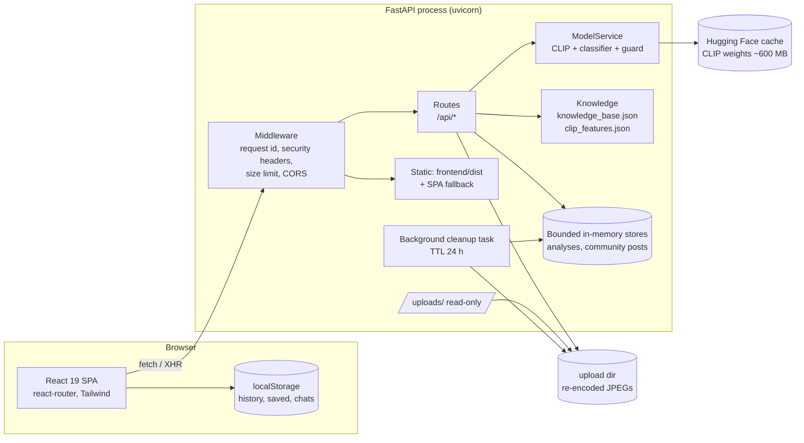
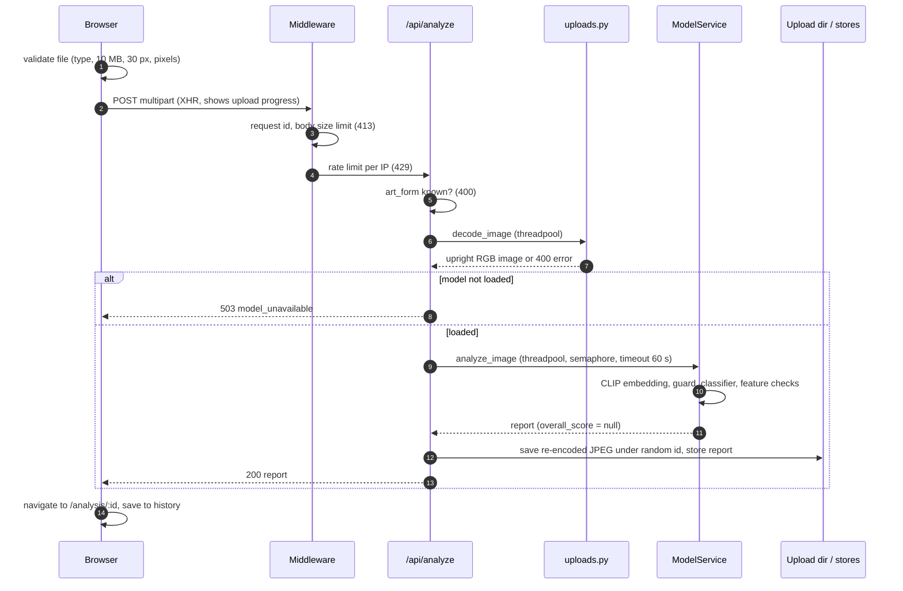
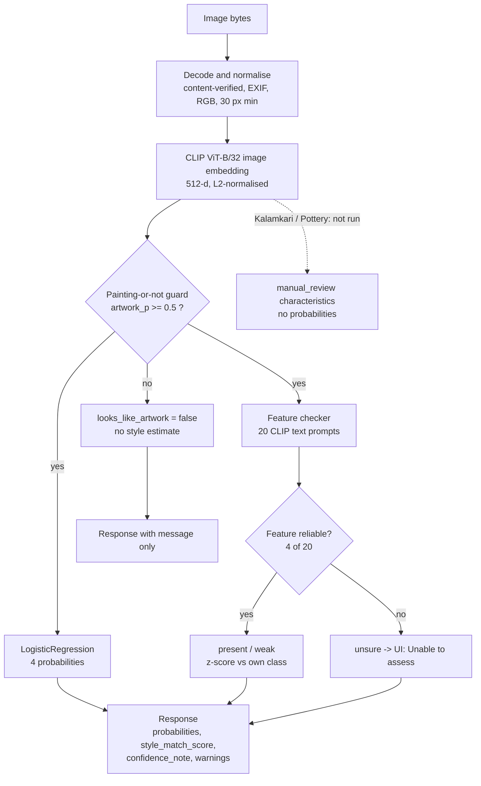
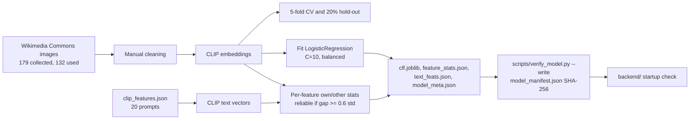
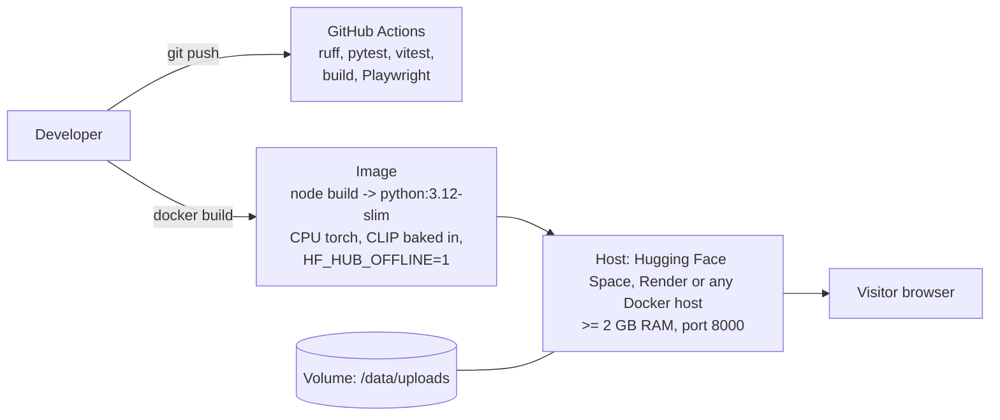
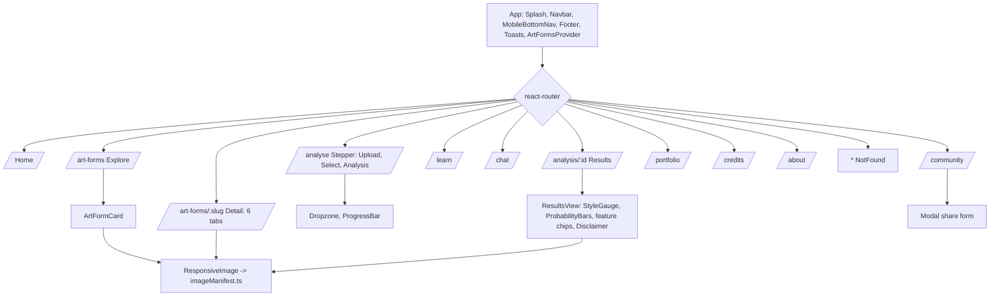

# Technical design

Parampara Proof is a single web application: a React front end and a FastAPI back end that also serves the built front end. One process, one port, no database, no paid AI service.

## 1. System architecture

The model files (`clf.joblib`, `feature_stats.json`, `text_feats.json`, `model_meta.json`, plus the content files) live in `backend/` and are pinned by SHA-256 in `backend/model_manifest.json`.

## 2. Request sequence: `POST /api/analyze`

The event loop never runs inference: it is done in a worker thread, limited by a semaphore (default 2) and a timeout (504).

## 3. Model pipeline

## 4. Data and training pipeline

`ml/train_clip_classifier.py` implements this. The original Colab notebook is not in the repository.

## 5. Deployment

## 6. Front end route and component map

All routes are lazy-loaded. Shared UI: Button, Chip, Card, Badge, Tabs, Stepper, Dropzone, ProgressBar, Modal, Toast, Skeleton, EmptyState, ErrorState, SectionHeader, ResponsiveImage.

## 7. Design decisions and trade-offs

- **CLIP + logistic regression.** With 132 training images, fine-tuning a network would overfit. A frozen general image model with a linear head is cheap to train, runs on CPU, and gives usable probabilities. The cost is that it can only see what CLIP encodes and is sensitive to image style (see the model card).
- **No quality score.** No score was ever validated against human judgement, so none is produced. `overall_score` is `null` in the API; the UI shows "Style similarity" and says what it is not. This is the project's central honesty rule.
- **Feature checker shows only reliable features.** Only 4 of 20 prompts separate their own class from the others. Showing "present/missing" for the other 16 would be guessing, so they show "Unable to assess".
- **Guard before estimate.** Without it, a selfie or screenshot still gets a confident-looking style probability, because the classifier must pick one of four classes.
- **No database.** Analyses and community posts live in bounded in-memory stores and are lost on restart; uploads expire after 24 h. This keeps the prototype simple and private. A real deployment would need persistence and accounts.
- **Guest data stays in the browser** (`localStorage`), so the server never lists other people's analyses.
- **Content is served by the same process** as the API, so one container and one port serve everything; Vite's dev server proxies `/api` and `/uploads`.
- **Degraded mode.** If the model fails to load, the API still starts and serves content; `/api/analyze` returns 503 and the UI shows "analysis temporarily unavailable". Set `STRICT_MODEL_CHECK=1` (the Docker image does) to refuse to start instead.

## 8. Security and privacy design
- Uploads are validated by content (Pillow), not by name or `Content-Type`; size, dimension and pixel caps protect against decompression bombs.
- Stored images are re-encoded (EXIF/GPS dropped) under random ids; user file names never reach the disk; `/uploads` is read-only static serving.
- Auto-deletion after `UPLOAD_TTL_HOURS` (default 24) by a background task; the UI says so.
- CORS allows only `ALLOWED_ORIGINS`, credentials are off; per-IP rate limiting on `/api/analyze` and `/api/chat`; request size limit; security headers incl. CSP.
- Error responses are generic JSON; stack traces are logged server-side with a request id.
- SPA static serving resolves paths and refuses anything outside `frontend/dist`.
- No analytics, no cookies, no third-party requests at runtime (fonts are self-hosted). The only network use is the one-time CLIP download.

## 9. Performance notes
- CLIP is loaded once at startup (and warmed up), not on the first request. First start downloads about 600 MB unless the cache is pre-filled (`scripts/download_model.py`).
- Inference runs in a thread pool with `torch.set_num_threads(min(4, CPUs))`.
- Front end: route-level code splitting, hero image preloaded, other images lazy with fixed aspect ratios (no layout shift), WebP with JPEG fallback at 480/960/1600 px, self-hosted fonts with `font-display: swap`.

## 10. Testing strategy
- `pytest` (`tests/`): upload edge-case matrix, API success and error paths, stores and rate limiter, manifest checks, chat rules, and tolerant behaviour tests with the real model.
- `vitest`: components (results states, dropzone, stepper, tabs, image fallback), validation and storage helpers.
- `playwright`: end-to-end flows on desktop and mobile, per-route checks (overflow, console errors, failed requests, image loading) and screenshots.
- Details and the latest run: `docs/TEST_REPORT.md`.

## 11. Limitations
Small model and dataset; weak on Madhubani; out-of-distribution on illustrations; guard threshold calibrated on seven images; content not reviewed by artists; no accounts, persistence or moderation; English only; no real lesson videos; no Pattachitra image.
